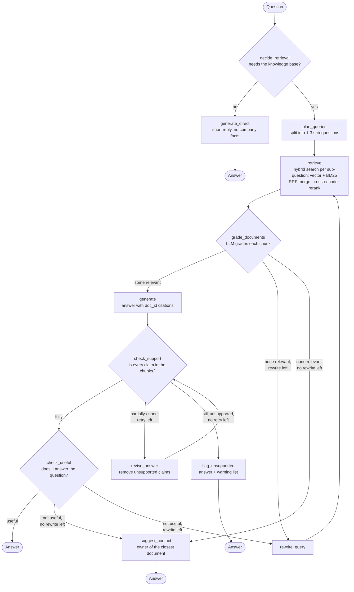

# Self-RAG: Self-Reflective Retrieval-Augmented Generation with LangGraph

**OrbitBot** is an internal assistant for a fictional company, Orbitra Technologies. It answers employee questions
about HR, IT, finance, security and other policies, and **checks its own work at every step**:

- does this question need the knowledge base at all?
- are the retrieved chunks relevant?
- is the answer supported by them?
- does the answer actually help?

When a check fails, it fixes the problem by revising the answer or rewriting the search query, instead of
passing a bad answer on. Built with LangChain + LangGraph, following the ideas of the
[Self-RAG paper (Asai et al., 2023)](https://arxiv.org/abs/2310.11511).

---

## Why Self-RAG? What traditional RAG gets wrong

A traditional RAG pipeline is a straight line:

```
question -> retrieve top-k chunks -> stuff them into the prompt -> LLM answers
```

It never asks whether any step worked. On a realistic company knowledge base that causes real failures:

| Problem in traditional RAG | Example from this knowledge base | How Self-RAG handles it |
|---|---|---|
| It retrieves even when no documents are needed | "hi" or "thanks" triggers a search and a policy-flavoured reply | **`decide_retrieval`** (Retrieve): skip search for small talk |
| Outdated or wrong-region chunks get used | The archived leave policy v4 says comp-off expires in **30** days; the active v5 says **60** | **`grade_documents`** (IsRel): an LLM grades each chunk using its `status` and `applies_to` metadata |
| The LLM adds facts that are not in the context | An invented approval step or a wrong number | **`check_support`** (IsSup): every claim is checked against the chunks; **`revise_answer`** removes the unsupported ones |
| The search missed, so the answer is "I don't know" | The right chunk ranked #6 when only the top 4 are used | **`check_useful`** (IsUse) + **`rewrite_query`**: search again with better words |
| A question needs facts from two documents | "Can I deploy on 9 Nov?" needs the freeze dates **and** the holiday list | **`plan_queries`**: one search per part |
| Nothing answers, and the bot just says "don't know" | "Does Orbitra provide pet insurance?" | **`suggest_contact`**: points to the owner of the closest document |

**Self-RAG vs CRAG:** CRAG (my earlier project) adds one correction step between retrieval and generation and falls
back to web search. Self-RAG reflects at several points, *including after the answer is written*, and stays inside the
company knowledge base. Internal policy questions shouldn't be answered from the web.

> The paper trains a model to emit special *reflection tokens* (`Retrieve`, `IsRel`, `IsSup`, `IsUse`).
> This project gets the same decisions without fine-tuning: each reflection is a separate LLM call that
> returns a Pydantic object (structured output), and LangGraph routes on the result.

---

## How this project works



Both loops are bounded: at most **1 revision** (`MAX_GENERATIONS = 2`) and **1 query rewrite** (`MAX_REWRITES = 1`).
The longest possible path is 18 steps, well below LangGraph's default `recursion_limit` of 25.

### Step by step

1. **`decide_retrieval`** (Self-RAG *Retrieve*): returns `RetrievalDecision(should_retrieve, reason)`. Anything about
   Orbitra, even if it sounds general ("how do I reset my password?"), is retrieved. Greetings and small talk go to
   **`generate_direct`**, which is told not to state any company facts.
2. **`plan_queries`**: splits a multi-part question into 1-3 sub-questions (`QueryPlan(sub_questions)`), so
   each fact gets its own search. "Can I deploy a feature on 9 November?" becomes "What are the deployment
   windows and freeze periods?" + "Is 9 November 2026 a holiday?". Simple questions come back unchanged as one part.
3. **`retrieve`**: hybrid search, explained below, once per sub-question: the 4 best chunks for a single question,
   or 3 per part for several, with duplicates removed. After a rewrite it searches only with `search_query`.
4. **`grade_documents`** (Self-RAG *IsRel*): one `DocGrade(is_relevant, reason)` per chunk, sent in parallel with
   `grader.batch`. The grader sees each chunk's `doc_id`, `title`, `status` and `applies_to`, so a `superseded` chunk
   or one for a different region is rejected. Only relevant chunks are kept in the state.
   The grader also sees the sub-questions, so a chunk that answers just one part (e.g. the holiday list) is kept.
5. **`generate`**: answers from the kept chunks only and cites every source like `[HR-LV-001]`. If the answer
   depends on something the user didn't say (location, level), it lists the options and asks.
   It gives the direct answer first, then the conditions, exceptions and next steps the chunks state for it
   (who must approve, deadlines, what is not allowed), so a "2 approvals" answer also says "including a CODEOWNER".
6. **`check_support`** (Self-RAG *IsSup*): `SupportGrade(support = fully | partially | none, unsupported_claims)`.
   Numbers the user gave in the question (their salary, dates) count as supported, and so do direct
   calculations from them. "I don't know" and clarifying questions are not claims.
7. **`revise_answer`**: if the support check fails, it **edits** the previous answer: removes or corrects only the
   listed claims and adds nothing new. Then the support check runs again. If it still fails,
   **`flag_unsupported`** returns the answer with a ⚠️ list of the parts that could not be verified.
8. **`check_useful`** (Self-RAG *IsUse*): `UsefulnessGrade(is_useful, reason)`. It judges only whether the answer
   addresses the question, because correctness was already checked. A grounded "I don't know" fails this check.
9. **`rewrite_query`**: turns the question into a policy-style search query ("entitlement", "notice period") and
   loops back to `retrieve`. The rewrite is used **only for searching**: grading and generation still use the
   user's original question.
10. **`suggest_contact`**: the dead end, used when no chunk is relevant or the answer is still not useful after the
   rewrite. The LLM picks the retrieved document closest to the question (`ContactChoice(doc_id)`), and the reply
   points to that document's owner, e.g. "The closest policy is Employee Benefits and Insurance - India
   [HR-BEN-001], owned by People Operations - Total Rewards: you can ask them at benefits@orbitra.io."

### Example: one multi-part question, end to end

A real run of "Can I deploy a non-urgent feature to production on 9 November 2026?":

1. `decide_retrieval`: it's about Orbitra's rules, so retrieve.
2. `plan_queries` makes 2 parts: *"What are the deployment windows and freeze periods for non-urgent features in
   production?"* and *"Is 9 November 2026 a holiday according to the company holiday calendar?"*
3. `retrieve` runs one hybrid search per part (3 chunks each): 6 chunks.
4. `grade_documents` keeps 3 of them: the deployment rules (ENG-003), the Diwali-freeze announcement (COM-004) and
   the holiday calendar (HR-HOL-2026). A glossary chunk, a support-SLA chunk and a second holiday chunk are rejected.
5. `generate` combines them: *"No - a production deploy on 9 Nov 2026 isn't allowed without an approved exception"*,
   because 9 November is a holiday in Bengaluru and Pune, when production deploys aren't allowed [HR-HOL-2026],
   and 6-10 November is a deployment freeze [COM-004]; the normal deployment windows [ENG-003] don't apply.
6. `check_support`: fully supported. `check_useful`: useful. Done: 11 LLM calls, about 8,900 tokens.

Without step 2, a single search found only the deployment rules, and the bot answered "Yes, it's a Monday".

### What the graph passes between nodes (the state)

Nodes don't call each other; each one reads fields from a shared state (`GraphState`) and returns the fields it
changes. There are no reducers, so a returned field replaces the old value: that is how `grade_documents` swaps the
retrieved chunks for only the relevant ones.

| State field | Written by | Read by |
|---|---|---|
| `question` | the caller (the user's question) | almost every node |
| `should_retrieve`, `retrieval_reason` | `decide_retrieval` | `route_after_decision` |
| `sub_questions` | `plan_queries` | `retrieve`, `grade_documents` |
| `documents` | `retrieve` (all found), then `grade_documents` (only relevant) | `generate`, `revise_answer`, `check_support`, `suggest_contact` |
| `doc_grades` | `grade_documents` (with each chunk's title, department, owner) | `suggest_contact` |
| `answer` | `generate`, `revise_answer`, `flag_unsupported`, `suggest_contact`, `generate_direct` | `check_support`, `check_useful`, `revise_answer` |
| `generation_attempts` | `generate` (sets 1), `revise_answer` (+1) | `route_after_support` |
| `support`, `unsupported_claims` | `check_support` | `route_after_support`, `revise_answer`, `flag_unsupported` |
| `is_useful`, `usefulness_reason` | `check_useful` | `route_after_useful` |
| `search_query`, `rewrite_count` | `rewrite_query` | `retrieve`, `rewrite_query`, the routers |

### How many LLM calls a question costs

| Path | LLM calls |
|---|---|
| Small talk ("hi") | 2: decide + direct reply |
| Normal question | 9: decide, plan, 4 chunk grades, generate, support check, usefulness check |
| Split into 2 parts | 11: 6 chunk grades instead of 4 |
| A revision after a failed support check | +2: revise + support check again |
| A query rewrite | +8: rewrite, 4 chunk grades, generate, support check, usefulness check |
| Ending in `suggest_contact` | +1: picking the closest document |

Everything else (embeddings, BM25, reranking, routing) runs locally and costs no tokens.

### Retrieval: hybrid search + reranking

Embedding search can miss exact terms such as policy names and abbreviations ("comp-off", "per diem"), so
retrieval combines two searches and then reranks:

```
question ─┬─> vector search (bge-small, Chroma)  top 12 ─┐
          └─> BM25 keyword search (rank-bm25)    top 12 ─┴─> Reciprocal Rank Fusion ─> top 12
                                                               ─> cross-encoder rerank ─> top 4
```

- **Vector search** finds chunks by **meaning**: the embedding model (`bge-small`) turns each chunk into a list of
  384 numbers once, when the vector store is built, and turns the question into the same kind of list at search
  time; the closest chunks win. It matches "quit my job" to "resignation" without shared words, but each chunk is
  one averaged vector, so a single rare word in a big table (like "comp-off") can get lost.
- **BM25** scores chunks by the exact words they share with the question, so rare words like "comp-off" or
  "buyout" score high. Text is lowercased and split on `\w+`.
- **Reciprocal Rank Fusion (RRF)** merges the two rankings. A chunk gets `1 / (60 + rank)` from every list it
  appears in, so chunks ranked high in both lists come first. No score scaling is needed. It is ~10 lines,
  written by hand in `reciprocal_rank_fusion()`.
- **Cross-encoder reranker** (`jinaai/jina-reranker-v1-turbo-en`, local ONNX): reads the question and each chunk
  *together*. That judges relevance much better than comparing two separate embeddings. About 1 second for 12 chunks on a CPU.
  The difference in one line: vector search turns the question and the chunk into vectors **separately** (fast,
  chunk vectors computed in advance); the reranker **reads them together** (precise, but one model run per chunk),
  so it only runs on the 12 candidates.

### Design choices worth knowing

- **Rate limits shape the design.** Groq's free tier for `openai/gpt-oss-120b` allows about **8,000 tokens/minute**
  and **200,000 tokens/day**. Each question makes several LLM calls, so:
  - the yes/no judges (decider, grader, support, usefulness, rewriter) use a separate `judge_llm` with
    `reasoning_effort="low"`, which means fewer reasoning tokens;
  - both clients use `max_retries=6`, so a per-minute `429` waits and retries instead of crashing;
  - only the top 4 chunks (or 3 per sub-question) reach the LLM grader, because reranking is local and free.
- **`llm.bind(reasoning_effort=...)` doesn't work with structured output.** `with_structured_output` silently drops
  bound arguments (measured: the same reasoning-token count with and without it). Setting it on a second `ChatGroq` instance works.
- **Separate nodes for separate jobs.** Revising an unsupported answer is its own node (`revise_answer`), not a hidden
  "retry mode" inside `generate`. The graph picture then shows exactly what happens.
- **Metadata does the version-conflict work.** Every Markdown file has YAML front-matter (`doc_id`, `status`,
  `applies_to`, ...). It is copied into each chunk's metadata, and the grader uses it to reject superseded and
  wrong-region chunks.
- **The rewriter must not copy the user's numbers.** An early version put the user's salary into the search query,
  which made retrieval worse. The prompt now says so explicitly.
- **The LLM decides when to split, before searching.** Simple rules (look for "and") miss hidden multi-part
  questions: "Can I deploy on 9 November?" has no "and" but needs the freeze dates and the holiday list. And
  waiting for a check to fail doesn't work either: with only the deployment rules retrieved, the answer "Yes,
  it's a Monday" passed both the support and usefulness checks, because no check can see a document that was never
  retrieved. So `plan_queries` asks the LLM up front, with examples of how this knowledge base splits its facts.
- **Contacts come from metadata, not from the LLM.** In `suggest_contact` the LLM only chooses a `doc_id` from
  the retrieved documents; the team and email are read from that document's `department` and `owner` fields,
  so the bot can't make up an email address.
- **Everything except the LLM runs locally:** embeddings, the vector store, BM25 and the reranker. You only need
  one free API key.

---

## The knowledge base

`documents/` holds a **synthetic** company knowledge base. Everything in it is invented, so it is safe to publish.

- **46 Markdown documents** in 11 departments (HR, IT, security, finance, admin, legal, engineering, product, sales/CS,
  learning). They are split into **154 chunks** (1,000 characters, 150 overlap).
- **Built-in traps:** a superseded leave policy (`01_hr/archive/…v4_SUPERSEDED.md`), region-specific rules
  (India / US / UK), similar-but-different facts (internal IT P1 SLA 15 min vs customer P1 30 min), multi-hop questions,
  calculations, and unanswerable questions.
- `data/`: an employee directory and ticket history CSVs. They are not used here; they're meant for an Agentic RAG
  version with tools.
- `eval/eval_questions.jsonl`: 50 graded test questions, used by `eval/run_eval.py`.

See [`KB_README.md`](KB_README.md) for the full description and document index.

---

## Requirements

### Hardware and disk

Measured on a laptop with an 8-core CPU and 7.5 GB RAM (Linux), no GPU:

| What | Size on disk | Created when |
|---|---|---|
| Python environment (`.venv`) | ~570 MB | `uv sync` |
| Embedding model (bge-small-en-v1.5, quantized ONNX) | ~65 MB | first run, downloaded automatically |
| Reranker model (jina-reranker-v1-turbo-en, ONNX) | ~147 MB | first run, downloaded automatically |
| Vector store (`chroma_db/`, 154 chunks) | ~2 MB | first run, built automatically |
| Knowledge base (`documents/` + `data/`) | < 1 MB | included in the repo |
| **Total in the project folder** | **~0.8 GB** | |

### RAM

| Phase | RAM |
|---|---|
| Asking questions (vector store, BM25 index, embedding model and reranker loaded) | ~0.6 GB peak (measured) |
| Startup | ~5 seconds |
| Retrieval per search (hybrid + rerank) | ~1.1 seconds |

Embedding runs in small batches (`batch_size=16`) on purpose: fastembed's default of 256 used more than 1.5 GB of RAM
and froze a 7.5 GB laptop.

### Account (free tier)

- **Groq** API key for the LLM: <https://console.groq.com/keys>

---

## Setup

### 1. Install uv

[uv](https://docs.astral.sh/uv/) manages Python, the virtual environment and the dependencies:

```bash
# Linux / macOS
curl -LsSf https://astral.sh/uv/install.sh | sh

# Windows (PowerShell)
powershell -ExecutionPolicy ByPass -c "irm https://astral.sh/uv/install.ps1 | iex"

# or, with pip
pip install uv
```

You don't need to install Python yourself: uv reads `.python-version` (3.12) and downloads it if needed.

### 2. Clone and install dependencies

```bash
git clone <this-repo-url>
cd SelfRAG
uv sync
```

`uv sync` creates `.venv/` and installs the exact versions pinned in `uv.lock`.

> **Project on a different drive than your home folder (e.g. an NTFS partition mounted on Linux)?** uv hard-links
> packages from its cache, and hard links can't cross drives, so it warns and falls back to copying. Run
> `export UV_LINK_MODE=copy` first to skip the attempt (Windows PowerShell: `$env:UV_LINK_MODE="copy"`).

### 3. Add your API key

Create a file named `.env` in the project root:

```env
GROQ_API_KEY=your_groq_key
```

`.env` is in `.gitignore`, so your key is never committed.

### 4. Run it

```bash
uv run main.py
```

Type a question at the `You:` prompt, or `exit` to quit. The knowledge base is already in `documents/`, so there is
nothing else to add.

**Notebook version:** `main.ipynb` has the same code as `main.py`, split into sections (loading, vector store,
hybrid search, each Self-RAG step, the graph and its diagram), plus example questions. Open it in VS Code or Jupyter
and select the `.venv` kernel.

---

## What to expect

### First run

| Step | What you see |
|---|---|
| Download the embedding model (~65 MB) | `Fetching 5 files: ...` progress bar |
| Build the vector store | `Building vectorstore from 154 chunks...` then `embedded 16/154 chunks`, ... |
| Download the reranker (~147 MB) | another download progress bar |

Later runs load everything from `chroma_db/` and `models/` and start in about 5 seconds. If a build is interrupted,
the next run notices the incomplete store (`Vectorstore is incomplete ...`) and rebuilds it.

### While answering

Every node prints what it did, so you can watch the self-reflection happen (output shortened):

```
You: How long is a comp-off valid?
--- decide_retrieval ---
  retrieve=True  (...)
--- plan_queries ---
  🧩 parts: ['How long is a comp-off valid?']
--- retrieve ---
  [HR-LV-001] status=active  '...'
  ...
--- grade_documents ---
  ✓ [HR-LV-001] ...
  ✗ [HR-LV-002] ...
--- generate ---
A comp-off must be taken within **60 days** of earning it. [HR-LV-001]
--- check_support ---
  support=fully
--- check_useful ---
  useful=True  (...)
```

When a check fails you will also see `✗` lines with unsupported claims, a `--- revise_answer ---` step, or
`🔁 new query: '...'` followed by a second retrieval.

---

## Configuration

All in `main.py` (and the matching notebook cells):

| Setting | Default | Meaning |
|---|---|---|
| `CANDIDATES` | 12 | chunks taken from each of vector and BM25 search, and kept after RRF for reranking |
| `TOP_K` | 4 | chunks kept after reranking; each costs one grader LLM call |
| `MAX_SUB_QUESTIONS` | 3 | most sub-questions `plan_queries` can make |
| `TOP_K_PER_PART` | 3 | chunks per sub-question when a question is split |
| `MAX_GENERATIONS` | 2 | first answer + 1 revision after a failed support check |
| `MAX_REWRITES` | 1 | query rewrites (after no relevant chunks, or a not-useful answer) |
| `chunk_size` / `chunk_overlap` | 1000 / 150 | text splitting; the vector store rebuilds itself when the chunk count changes |
| embeddings `batch_size` | 16 | lower = less RAM while building the vector store |

---

## Troubleshooting

| Symptom | Fix |
|---|---|
| Slow answers with long pauses | Normal on the free tier: a `429` per-minute limit makes the client wait and retry (`max_retries=6`). |
| `Rate limit reached ... tokens per day (TPD)` | The 200K tokens/day limit is used up. It is a rolling 24-hour window; try again later. |
| Answers don't reflect edited documents | Delete `chroma_db/` and run again to rebuild. |
| The computer freezes while building | Not enough free RAM. Close other apps; don't raise the embeddings `batch_size`. |
| `uv sync` warns `Failed to hardlink files` | Harmless; set `UV_LINK_MODE=copy` (see Setup step 2). |

---

## Project structure

```
SelfRAG/
├── main.py               # the full Self-RAG graph + command-line chat loop
├── main.ipynb            # same code as notebook sections, with the graph diagram and examples
├── eval/
│   ├── eval_questions.jsonl  # 50 graded test questions (reference answers + gold documents)
│   └── run_eval.py           # resumable eval: runs the graph, LLM-judges each answer
├── documents/            # synthetic Orbitra knowledge base (46 Markdown docs)
├── data/                 # employee directory + ticket history CSVs (meant for an Agentic RAG version)
├── KB_README.md          # description of the knowledge base and its built-in challenges
├── pyproject.toml        # dependencies
├── uv.lock               # exact pinned versions
├── .python-version       # Python 3.12
├── .env                  # your API key (create it; not committed)
├── chroma_db/            # vector store (built on first run; not committed)
└── models/               # embedding + reranker models (downloaded on first run; not committed)
```

## How it was built (one stage per commit)

| Stage | What it added |
|---|---|
| 1 | Basic RAG: retrieve (top 4) -> generate, CLI loop |
| 2 | `decide_retrieval` with structured output and the first conditional edge |
| 3 | `grade_documents`: per-chunk relevance grading using metadata |
| 4 | `check_support` with a bounded revise loop (later moved into its own `revise_answer` node) |
| 5 | `check_useful` and the `rewrite_query` loop |
| + | Hybrid search (vector + BM25, RRF) with cross-encoder reranking |
| + | More complete answers: the conditions, exceptions and next steps from the chunks |
| + | `suggest_contact`: point to the owner of the closest document when nothing answers |
| + | `plan_queries`: split multi-part questions into sub-questions, one search each |

## Ideas for next steps

- ~~Follow the pointer~~ (tried, not added): 34% of chunks mention another document, but in a check over all
  50 questions only 2 of 64 followed pointers led to a missing document; most are "see also" links, and even
  scoring the pointer's line against the question couldn't tell the useful ones apart.
- **Tools** from `data/` (employee lookup, leave balance, ticket creation, a calculator) belong in an
  **Agentic RAG** project rather than here: they turn the bot into an agent that takes actions, which is a
  different pattern from Self-RAG's retrieve-and-check loop. Until then, `suggest_contact` points to the right team.

## Tech stack

LangGraph · LangChain · Groq (`openai/gpt-oss-120b`) · Pydantic · FastEmbed (bge-small embeddings, jina cross-encoder) ·
Chroma · rank-bm25 · uv

## References

- Asai, A., Wu, Z., Wang, Y., Sil, A., & Hajishirzi, H. (2023). *Self-RAG: Learning to Retrieve, Generate, and
  Critique through Self-Reflection.* [arXiv:2310.11511](https://arxiv.org/abs/2310.11511)
- Cormack, G. V., Clarke, C. L. A., & Büttcher, S. (2009). *Reciprocal Rank Fusion outperforms Condorcet and
  individual Rank Learning Methods.* SIGIR.
